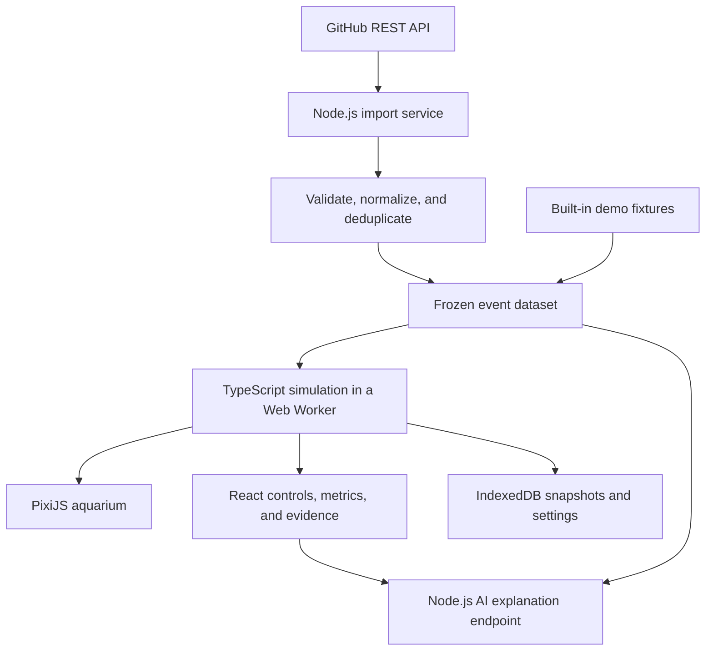

# Git Aquarium

**Your repository is an ecosystem. Your code is alive.**


*The built-in demo as a timelapse: 30 days of a fictional repository replayed as a living aquarium. It takes about three minutes at normal speed.*

Git Aquarium is an artificial-life simulator that turns GitHub development activity into environmental changes inside a digital aquarium. Virtual organisms forage, consume energy, reproduce, inherit traits, mutate, and die, while repository events influence the resources and conditions around them.

The goal is to make software history visible, explorable, and explainable through **artificial life, reproducible replay, and evidence-based interpretation**.

> **Project status: the four-week MVP is implemented.** Running today: a seeded, deterministic artificial-life simulation (foraging, energy, reproduction, inheritance, mutation, death), the Git-to-ecology mapping rules, an offline synthetic demo, import of one public GitHub repository, replay with pause, 1x / 2x / 4x speed, reset, and seed, organism inspection, lineage filtering, a population chart, and the Ecologist. The Ecologist explains by fixed rules unless a model key is supplied; the model path was tested against a stand-in server and has not been run against the real API. Measured results and known gaps are under [Validation results](#validation-results). Sections written in the future tense describe the original proposal, and each says where the implementation differs. A second view, Projects, maps one repository to one body: pull requests as bones, issues as scales, and upkeep as movement.

## What you are watching

The timelapse is the built-in synthetic demo with seed 1: 68 fictional repository events on four branches replayed against a living population. Reset with the same seed and it plays out the same way every time.

| Replay | Repository activity | In the aquarium |
| --- | --- | --- |
| Days 0–9 | Two commits a day spread over all four branches, most of them on `main` | Each commit drops food in its own branch's colour. The tank grows from 64 to about 100, and `main` grows most |
| Days 9–16 | CI fails on `main`, `feature/coral-cache`, and `fix/pump-timeout`, and work on them stops. Only `experiment/glow` keeps getting commits | The three failing lineages pay an energy penalty and get no food, so they shrink (`main` from about 33 to 14). The experiment's lineage holds steady at about 20. The tank falls to about 42 |
| Days 16–30 | Each workflow passes again. The two finished branches merge into `main` and go quiet, while `main` and the experiment carry on | Each merge releases food for `main`, which recovers to about 34, level with the experiment. The two merged branches stay small. The tank ends near 80 |

How to read the tank:

- **Species and colour** are the lineage, one per observed branch: each branch is its own kind of fish (a reef fish, a slim dart, a tall disc, a fantail), shown beside its name in the legend. Repository events act on the lineage of their own branch, so a lineage does well when its branch is active and its CI is passing. Fish of a lineage school together, and each fish's own `hue` gene shifts its shade slightly. With more than four branches the four shapes repeat in new colours.
- **A pale, washed-out fish** is a hungry one; colour returns as it feeds.
- **Size, slimness, fin size, and tail-beat speed** come from each fish's genes: faster swimmers are slimmer and beat their tails faster.
- **Coloured pellets** are food for the lineage of that colour: a commit feeds its own branch's lineage, and a merge feeds the lineage of the branch it merged into. **Pale pellets** are the small baseline supply, which anyone may eat.
- **Murky green water** means CI is failing somewhere. Only the lineage of the failing branch pays for it: its entry in the Lineages list is marked "CI penalty" and its fish turn pale as they go hungry. The water shows the average across lineages.
- **A dashed arc** joins a fish from each lineage when a pull request opens between their branches; **a solid arc** marks a merge.
- **A fish that grows in from nothing** was just born; **one that fades and sinks** has died.
- **The timeline** under the tank marks every event: red for a CI failure, white for a merge.
- **The panel on the right** lists each replayed event, the rule it triggered, and a link to its GitHub source when the data is real.
- **Click a fish** to follow it: a ring tracks it and the Organism panel shows its genome, energy, age, and parents, then how it died. Click open water to let it go.
- **Click a lineage** to fade the others in the tank and the chart. The Ecologist then answers about that lineage alone.
- **The chart** under the measurements plots each lineage's population, shaded while a CI penalty is active. Hover for the exact counts.
- **The tick readout** beside the speed control also shows a hash of the whole state while paused. The same seed and dataset give the same hash at the same tick.

### Ask why


The Ecologist answers from what was recorded, in four parts: facts, the rules that ran, an interpretation, and what the records cannot establish. Each statement lists the replayed events it rests on, linked to GitHub when the data is real. The answer above was written by fixed rules, and is labelled as such.

Move the pointer over the tank to shift the view.

The population figures are simulated measurements from one seeded run. They are not benchmarks and say nothing about code quality.

## Projects: one repository, one fish

Projects is a second reading of the tank, switched by the `Projects` tab beside the title. Each repository becomes one body: a fish while it is maintained, a seaweed once it has not been pushed to for 90 days, and a rock once it is archived or untouched for a year.

- **The spine is the project's theme**: the repository description, or its name when it has none.
- **Each rib is a pull request.** Merged ribs are pale bone, open ribs amber, and closed-without-merge ribs slate. Up to sixty ribs are drawn so a large project does not turn into a white blur; the panel reports the full count.
- **Each scale is an issue.** Closed issues are pale scales, open issues dark gaps in the coat, and issues labelled `question` are gold.
- **Length and height follow the number of pull requests** on a log scale, so a project with 300 pull requests stays visible beside one with 20,500.
- **Gloss and swim speed follow recent upkeep**: a project pushed to this week swims faster than one last touched in spring.
- **Age is read in the panel, not in the tank**: creation date, years, last push, and the lifecycle decision with the date that decided it.

Click a body to read its panel: project link and theme, age, upkeep, the bone split (merged, open, closed), the scale split (open issues, questions), and the five most recent pull requests with links. The reading bar counts projects, lifecycle states, pull requests, and issues.

Data boundaries: each project costs three unauthenticated GitHub requests (the repository, the latest hundred pull requests, the latest hundred issues), and GitHub allows 60 an hour per address, so loading eight projects uses a third of an hour's budget. Totals are lower bounds from GitHub's page count; only the latest hundred of each list are drawn. When a project cannot be read its error is listed and the rest still load.

## The idea
A repository becomes an aquarium. Its branches provide the identities of organism lineages, and each lineage contains multiple simulated individuals. Commits introduce resources, pull requests create visible interactions, and supported CI results change the simulated environment according to explicit rules.

The organisms also have their own lives. They compete for food, spend energy to move, and pass traits to their offspring. Git history supplies environmental inputs; the simulation determines how individuals respond.

```text
Repository
  └── Branch / lineage
        ├── Organism A
        ├── Organism B
        └── Offspring with inherited and mutated traits
```

**A branch is a lineage, rather than a single fish.** Reproduction never creates a real commit, and an organism's death never deletes a branch.

## Planned experience

1. Open the built-in demo or enter a public GitHub repository URL.
2. Review the imported time window, supported data, and any missing or truncated records.
3. Play the aquarium alongside a chronological repository timeline.
4. Select an organism to inspect its genome, energy, age, lineage, and parents.
5. Select an event to see its GitHub source and the ecological rule it triggered.
6. Ask the AI Ecologist why an observed change occurred.
7. Reset with the same seed and dataset to reproduce the experiment.

All seven steps work today. Step 5 is an event log that shows every replayed event with its rule and source link. Step 6 answers by fixed rules unless a model key is supplied (see [AI Ecologist](#ai-ecologist)).

The built-in demo works without network access. Synthetic demonstration events and recorded repository data are labeled separately.

## Four-week MVP scope

| Area | Planned MVP |
| --- | --- |
| Artificial life | Foraging, energy consumption, maturation, reproduction, mutation, and death |
| Genetics | Eight normalized traits, two-parent inheritance, bounded mutation, and parent references |
| Aquarium | Interactive rendering (now 3D rather than the 2D first planned), lineage colors, organism selection, and food particles |
| GitHub import | One public repository; commits, pull requests, and supported GitHub Actions runs |
| Replay | Play, pause, 1x / 2x / 4x speed, reset, and a configurable random seed |
| Inspection | Organism details, event evidence, rule identifiers, and lineage filtering |
| Metrics | Population, mean energy, and cumulative births and deaths, labeled as simulated measurements |
| AI Ecologist | On-demand explanations with evidence references and an explicitly labeled rule-based fallback |
| Delivery | Reproducible demo data, documentation, validation results, and a three-minute demonstration |

Full genealogy visualization, an interactive genetics laboratory, live webhooks, private repositories, multiple repositories, and user accounts are deferred beyond the MVP.

## From Git activity to ecology

These mappings are designed simulation rules, not measurements of software quality.

| Input | Planned aquarium effect | Interpretation boundary |
| --- | --- | --- |
| Observed branch snapshot | Initialize a lineage and its starting population. Up to eight branches: the default branch, then those with the most pull request and CI activity | A current branch snapshot does not establish its historical creation time |
| Deduplicated commit | Add a bounded amount of food for its branch's lineage | Commit volume is not a quality or productivity score |
| Pull request opened | Display an interaction between relevant lineages | Opening a PR is not a merge or biological reproduction |
| Confirmed PR merge | Add a bounded food pulse for the base branch's lineage, and a visual connection | A Git merge does not require simulated crossbreeding |
| Supported CI failure or timeout | Increase a bounded energy cost for its branch's lineage only | Failure does not establish poor overall code quality |
| Subsequent CI success in the same workflow and branch group | Clear that group's failure contribution and allow gradual recovery | Success in one group does not clear failures in another |
| No new Git records | Continue the configured baseline resource supply, shared by every lineage | Baseline food is a simulation rule, not fabricated Git activity |
| Commit or merge on a branch whose lineage has fewer than four organisms | Bring the lineage back up to four founders (R-BRANCH-FOUND) | Organisms dying never deletes a branch; founders have random genes and no parents |

Shared commits will be deduplicated by repository and SHA. A commit counts for the default branch if it is there, otherwise for the first lineage branch it was found on. Pull requests and workflow runs on branches that are not shown as lineages are left out and counted on screen. Unknown historical branch attribution will remain explicit, and resource effects will be capped so that busy repositories cannot create unlimited populations.

### Data boundaries

- **A commit is not a push event.** Historical commit imports will use a `COMMIT_OBSERVED` event and identify the committer timestamp as a replay proxy rather than claiming a verified push time.
- **Current branches are a snapshot.** Historical creation and deletion events will only be shown as facts when supporting records exist.
- **History may be incomplete.** Imports will report pagination limits, request budgets, missing fields, and unsupported sources. GitHub's Events API has a limited recent-history window and is not a complete historical ledger. See the [official Events documentation](https://docs.github.com/en/rest/activity/events).
- **CI coverage is deliberately limited.** The first version will support GitHub Actions workflow runs; absence of supported records will be shown as missing data.
- **Imported data is frozen before replay.** Network responses will not silently alter a running experiment.

## How the artificial life will work

Each organism will have a genome with eight fields:

| Trait | Planned role |
| --- | --- |
| `bodyLength` | Body scale, bounded energy capacity, and baseline cost |
| `finSize` | Fin appearance; cosmetic in the MVP |
| `hue` | Color variation within a recognizable lineage palette; cosmetic in the MVP |
| `speed` | Movement speed balanced against energy cost |
| `metabolism` | Baseline consumption and food conversion parameters |
| `perceptionRange` | Food detection range balanced against sensing cost |
| `lifespan` | Lifespan and maturation parameters |
| `mutationRate` | Bounded probability of small mutations during inheritance |

At each fixed simulation tick, the engine will apply scheduled events, introduce resources, update perception and movement, resolve food consumption, update energy and age, process deaths, and create eligible offspring.

```text
Energy change = food gained
              - baseline metabolism
              - movement and sensing costs
              - environmental costs
              - reproduction costs
```

Reproduction will require two mature organisms from the same lineage with sufficient energy and expired cooldowns. Offspring will inherit recombined traits and may receive small mutations. Parental energy payments and population limits will prevent unrestricted growth.

Natural selection will emerge through differential survival and reproduction under resource constraints. The engine will not assign every organism a universal fitness score or guarantee that a particular trait always wins.

## Proposed architecture



| Layer | Proposed technology |
| --- | --- |
| UI | React, TypeScript, Vite, and CSS |
| 2D rendering | PixiJS 8.x |
| Simulation | Framework-independent TypeScript in a Web Worker |
| Import and explanation API | Node.js, Fastify, and fetch |
| Runtime validation | Zod |
| Browser persistence | IndexedDB |
| Workspace | pnpm workspace |
| Testing | Vitest and Playwright |

**Current implementation:** a single Vite + TypeScript package whose only runtime dependency is Three.js. The aquarium is drawn in 3D, in place of the 2D PixiJS view proposed in the table above.

- `src/sim.ts`: the simulation and the mapping rules, in three dimensions. Fish turn gradually, cruise level, and school with their own lineage. It has no dependencies and runs in a Web Worker (`src/worker.ts`).
- `src/dataset.ts`: validates, deduplicates, and freezes repository records, and imports one public repository.
- `src/demo.ts`: the fictional demo history.
- `src/tank.ts`: the 3D scene: sunlight with shadows, rippling light on the sand, depth haze, and four fish species, plants, and rocks modelled in code, so there are no downloaded art assets. It needs WebGL; without it the measurements and event log still work.
- `src/explain.ts`: the Ecologist's rule-based explanation, the bounded summary a model is given, and the checks applied to a model's answer. Pure functions with no DOM or network.
- `src/main.ts` and `src/style.css`: the page, controls, event log, organism panel, chart, and Ecologist panel. Motion is blended between simulation ticks at display frame rate. The two typefaces (Fraunces and Martian Mono) are bundled at build time, so the page still loads nothing from the network.
- `src/projects.ts`: the Projects mode. Turns one public repository into a project: pull request totals and the latest hundred, issue totals and the latest hundred, upkeep from the last push, and the lifecycle decision. No DOM and no Three.js.
- `src/fish.ts`: builds the body for a project: a spine for its theme, ribs for pull requests, scales for issues, and the rock and seaweed forms used by abandoned projects.
- `src/fishschool.ts`: the small deterministic drift that moves project bodies in the tank.
- `vite.config.ts`: the optional model endpoint, `POST /api/explain`, served by `pnpm dev` and `pnpm preview` only. The Anthropic SDK is a development dependency used here and nowhere in the page.

The import calls GitHub's public REST API directly from the browser, so there is no server and no token. That limits it to GitHub's unauthenticated quota of 60 requests per hour (four per import plus one per lineage, so at most twelve) and to the 100 most recent commits, pull requests, and workflow runs; whatever is cut off is listed on screen. React, PixiJS, the workspace split, Fastify, Zod, IndexedDB, and Playwright were not needed to meet the MVP and have not been introduced: the page is plain TypeScript and DOM, the model endpoint is a few lines of dev-server middleware, nothing is saved between visits, and browser checks were run with a script driving headless Chrome rather than a test suite in the repository.

The simulation package will not depend on React, PixiJS, network access, or storage APIs. Rendering will consume state without changing it. AI responses will explain recorded state without controlling organisms.

### Proposed repository layout

The following structure was the proposed end state. It has not been adopted, and all code lives in `src/`:

```text
apps/
  web/                    # Aquarium, controls, details, and Worker bridge
  api/                    # GitHub imports and AI explanation endpoint
packages/
  contracts/              # Shared types, validation, and version metadata
  simulation/             # RNG, lifecycle, behavior, genetics, rules, replay
fixtures/
  synthetic-demo/         # Clearly labeled fictional demonstration events
  recorded-repo/          # Imported public data with source attribution
tests/
  integration/
  e2e/
docs/                     # Architecture, mapping rules, limitations, validation
```

## Reproducibility

The planned replay contract is:

```text
Same seed + frozen dataset + parameters + engine/rule versions
    → same state at the same simulation tick
```

This guarantee will initially be validated within the same supported browser and engine version. Cross-browser bit-for-bit floating-point equivalence is outside the MVP scope.

The engine will use a serializable pseudorandom number generator, stable event ordering, and a fixed timestep. Playback speed will change scheduling rather than ecological rules. Reset will restore the random state, event cursor, entities, and environment.

The initial design uses 20 simulation ticks per second, 64 starting organisms, a population cap of 200, and at most 500 food particles. These are starting parameters for validation and tuning.

## AI Ecologist

The AI Ecologist will be called when a user asks a question, not once per organism or animation frame.

It will receive a bounded context containing population summaries, recorded deaths, relevant Git events, and executed mapping rules. Answers will separate:

- **Facts:** imported Git records and recorded simulation observations.
- **Applied rules:** the configured effects that actually executed.
- **Interpretation:** an explanation supported by those records.
- **Uncertainty:** missing evidence or relationships that cannot be established.

Example questions include “Why did this lineage decline?” and “Which recent repository event affected the aquarium?” Evidence identifiers will be checked server-side, and source links will come from stored records.

When the model is unavailable, the interface will identify its response as a rule-based explanation. Simulated population health will never be presented as a factual score of code quality or developer performance.

**Current implementation.** By default no model is involved: `src/explain.ts` writes the answer from the recorded readings and labels it "Rule-based explanation". It looks back up to 1,200 ticks to the reading that differs most from the present, so a fall is measured from its peak.

To use a model, start the server with a key:

```bash
ANTHROPIC_API_KEY=your-key pnpm dev
```

The page then sends `POST /api/explain` a bounded summary: the question, the recorded observations, the rule list, and at most the 40 most recent replayed events with titles cut to 80 characters. No source code is sent, and the key stays in the server process. The endpoint asks `claude-opus-5-5` for the same four-part structure, rejects any answer that cites an event that was not in the summary, and the page checks again before showing it. A rejected or failed answer is replaced by the rule-based one, with a note saying why. Event titles reach the model as untrusted data, and everything it returns is shown as plain text. A static build has no endpoint, so it always answers by rule.

This model path was exercised end to end against a stand-in server, including the rejection of invented evidence. It has not been run against the real API, so the first real call is the test of the request itself.

## Four-week delivery roadmap

The schedule assumes one developer working approximately 25 hours per week: 90 hours of planned work and 10 hours of final contingency. This was the plan; all four acceptance gates have since been met, with the gaps listed under [Validation results](#validation-results).

| Week | Focus | Work | Acceptance gate |
| --- | --- | --- | --- |
| 1 — Days 1–5 | Artificial-life foundation | Scaffold contracts and engine; implement seeded movement, food, energy, lifecycle, genetics, and Worker integration | Observe foraging, births, mutations, and deaths without GitHub access |
| 2 — Days 6–10 | Git-driven replay | Add ecological rules, demo fixtures, replay controls, bounded imports, normalization, and evidence links | Import one public repository and reproduce a frozen replay with the same inputs |
| 3 — Days 11–15 | Inspection and explanation | Add organism details, metrics, explanation logs, AI integration, evidence validation, and failure handling | Complete the three-minute story with clear evidence and labeled fallback behavior |
| 4 — Days 16–20 | Validation and delivery | Run integration/E2E checks, measure performance, prepare README and reports, record the demo, and rehearse | Deliver a repeatable package; reserve the final two days for fixes and submission |

If time becomes constrained, optional genealogy views, comparison experiments, advanced visual effects, and additional charts will be removed first. The core lifecycle, real import, reproducible replay, and evidence boundaries remain the priority.

## Validation targets

Planned checks include:

- Identical state hashes after 10,000 ticks for identical inputs in the validated environment.
- Matching state at the same tick under 1x and 4x playback; no simulation advancement while paused.
- Valid gene bounds, reproduction eligibility, energy accounting, and population limits.
- One commit resource effect per unique repository/SHA.
- Correct CI deduplication and workflow/branch state updates.
- Visible missing-data and import-truncation notices.
- Rejection of nonexistent AI evidence references.
- An offline demo and an end-to-end import → inspect → explain → reset flow.
- A 15-minute stability run and repeated resets.

The initial performance target for a specified desktop test machine is an average foreground frame rate of at least 50 FPS with 100 organisms and a simulation tick p95 below 10 ms. Additional 200-organism tests will characterize limits.

### Validation results

Measured on 2026-11-15 on one machine: Apple M5, 24 GB, Node.js 22.21.1, and Chrome 157 running headless with GPU rendering at 1440 by 1000. The unit tests are in the repository (`pnpm test`, 9 tests). The browser checks were run by a script and are not part of the repository. The frame rate, tick time, and stability figures were measured before events were made to act on their own lineage and were not repeated; the two live imports were.

| Target | Result |
| --- | --- |
| Identical state hashes after 10,000 ticks for identical inputs | Pass (unit test) |
| Matching state at the same tick under 1x and 4x | Pass in Chrome: paused at tick 798 after 1x and at tick 960 after 4x, the worker's state hashes equalled the engine run directly to those ticks |
| No advancement while paused | Pass: tick and state hash unchanged after 2.5 seconds |
| Gene bounds, energy range, population and food caps, birth and death accounting, reproduction eligibility | Pass (unit tests) |
| One commit effect per unique SHA; CI deduplication and workflow/branch state | Pass (unit tests) |
| Missing-data and truncation notices | Pass (unit test), and three notices appeared on a live import |
| Rejection of nonexistent AI evidence references | Pass (unit test), and end to end against a stand-in model server |
| Offline demo | The demo makes no request to another site. Asking the Ecologist tries the local endpoint and falls back when it is absent |
| Import, inspect, explain, reset | Pass on a live import of this repository: 26 commits, 4 pull requests, 4 merges, 0 CI runs, with every evidence link pointing to github.com |
| Per-branch mapping on live data | Pass on a live import of `vitejs/vite`: 8 lineages, 11 workflow runs on their branches, and at most 2 lineages under a CI penalty at once while the others were unaffected |
| Phone width (430 px) | Pass: single column with no horizontal scrolling |
| A browser without WebGL | Pass in Chrome with WebGL disabled: a message replaces the tank, and the measurements, chart, event log, lineage filter, pause, and Ecologist all work |
| 15-minute stability run and repeated resets | Pass: 72,000 ticks at 4x in 15 minutes at a steady 60 frames per second, memory between 35 and 57 MB with no growth, no errors, and 20 resets that each returned the same tick-0 state hash |
| At least 50 FPS with 100 organisms | 60.1 frames per second averaged over 10 seconds at 1x with 101 to 107 organisms |
| Simulation tick p95 below 10 ms | 0.73 ms with 90 to 110 organisms on the demo, and 0.26 ms with 190 to 200 on a synthetic load that holds the tank at its caps (engine alone in Node.js) |

Not validated:

- **Across engines.** Node.js 22 and Chrome 157 give different state hashes from tick 0, because `Math.cos` differs in the last bit for one starting direction. Replays are reproducible within one engine, which is the scope stated under [Reproducibility](#reproducibility).
- **The real model.** No API key was used. See [AI Ecologist](#ai-ecologist).
- **Frame rate with 200 organisms.** Only the simulation tick time was measured at that size.
- **Busy repositories replay a short window.** A live import of `vitejs/vite` held only two commits, because its 100 most recent workflow runs span so little time. The import says so under Data boundaries; a longer history needs more than one page per source (issue #8). With so little history, the differences between its lineages are still mostly chance.

### Three-minute demonstration

1. Open the app. The demo starts on its own; the badge says the data is synthetic.
2. Click a fish and read its genome, then click a lineage in the list to follow one branch.
3. Around day 9 CI fails on three branches: their lineages are marked "CI penalty" and shrink, while the fourth carries on. Click a failing lineage to see its line fall in the chart.
4. With that lineage still selected, ask the Ecologist "Why did the population change?" and read the facts, rules, and cited events for that branch.
5. Watch CI pass and two pull requests merge: `main` recovers on the merge food, and the merged branches go quiet.
6. Pause, note the tick and state hash, reset, and pause at the same tick: the hash is the same.
7. Import a public repository and open "Data boundaries" to see what was truncated or missing.

## Getting started

Requires Node.js 22+ and pnpm.

```bash
git clone https://github.com/jingchangzhao-gif/Git-Aquarium.git
cd Git-Aquarium
pnpm install
pnpm dev     # open the printed local URL
pnpm test    # determinism, snapshot resume, bounds, mapping rules, import normalization, and explanation checks
pnpm build   # type-check and production build
```

The app opens on the synthetic demo, which needs no network access. To replay a real project, enter a public repository as `owner/repo` or a github.com URL and press Import. Reset replays the same frozen dataset from the same seed.

## Access and data handling

The MVP will read public repositories only and will not modify code, create commits in imported repositories, merge pull requests, or delete branches.

Optional GitHub and model credentials will remain on the server. Repository text will be treated as untrusted data, and model requests will use structured summaries rather than source-code uploads. Today no GitHub credential is used at all, and the optional model key is read from the environment of the local dev server and never reaches the page.

## Inspiration and license

The artificial-life concept is inspired by Jeffrey Ventrella's [Gene Pool / Swimbots](https://www.swimbots.com/genepool/). This project plans an independent implementation and original visuals; the repository's license does not grant rights to third-party code or assets.

Git Aquarium is licensed under the [MIT License](LICENSE).

