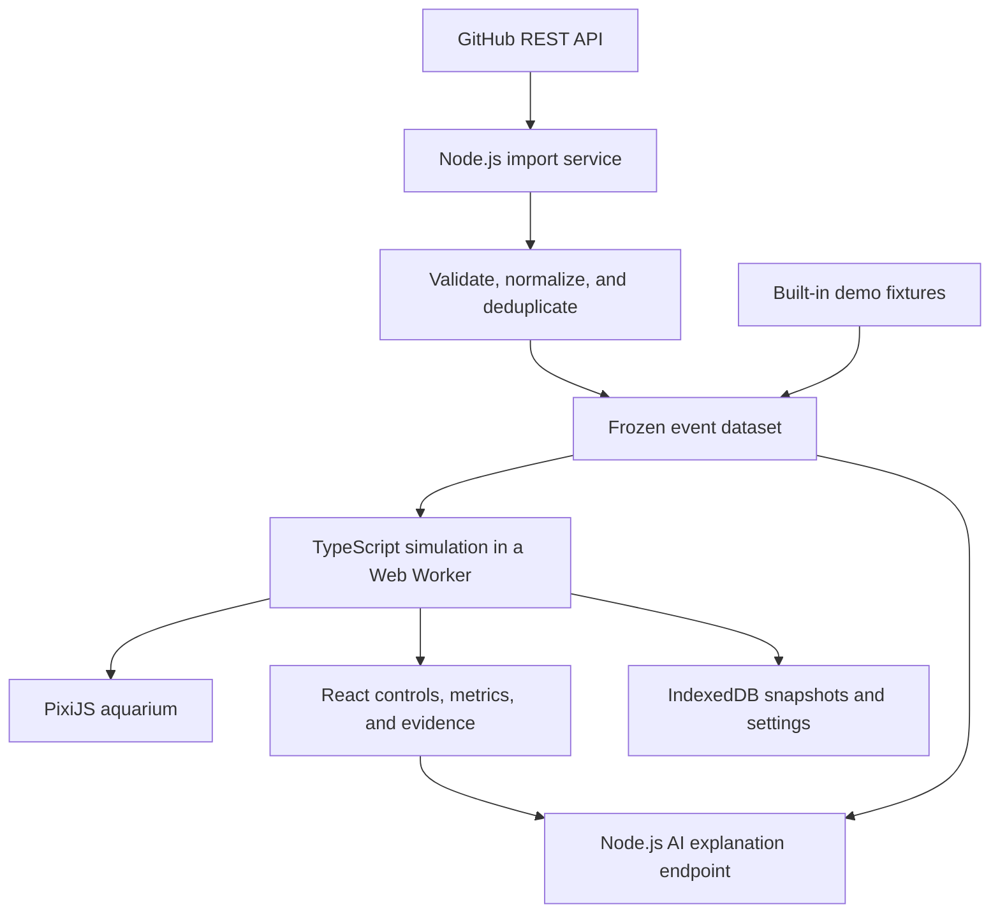

# Git Aquarium

**Your repository is an ecosystem. Your code is alive.**

Git Aquarium is a planned artificial-life simulator that turns GitHub development activity into environmental changes inside a digital aquarium. Virtual organisms forage, consume energy, reproduce, inherit traits, mutate, and die, while repository events influence the resources and conditions around them.

The goal is to make software history visible, explorable, and explainable through **artificial life, reproducible replay, and evidence-based interpretation**.

> **Project status: planning / pre-implementation.** The application has not been implemented yet. The features, architecture, roadmap, and performance figures below describe the intended four-week course or competition MVP; they are not claims of working functionality or measured results.

## The idea

A repository becomes an aquarium. Its branches provide the identities of organism lineages, and each lineage contains multiple simulated individuals. Commits introduce resources, pull requests create visible interactions, and supported CI results change the simulated environment according to explicit rules.

The organisms also have their own lives. They compete for food, spend energy to move, and pass traits to their offspring. Git history supplies environmental inputs; the simulation determines how individuals respond.

```text
Repository
  └── Branch / lineage
        ├── Organism A
        ├── Organism B
        └── Offspring with inherited and mutated traits
```

**A branch is a lineage, rather than a single fish.** Reproduction never creates a real commit, and an organism's death never deletes a branch.

## Planned experience

1. Open the built-in demo or enter a public GitHub repository URL.
2. Review the imported time window, supported data, and any missing or truncated records.
3. Play the aquarium alongside a chronological repository timeline.
4. Select an organism to inspect its genome, energy, age, lineage, and parents.
5. Select an event to see its GitHub source and the ecological rule it triggered.
6. Ask the AI Ecologist why an observed change occurred.
7. Reset with the same seed and dataset to reproduce the experiment.

The built-in demo is intended to remain usable without network access. Synthetic demonstration events and recorded repository data will be labeled separately.

## Four-week MVP scope

| Area | Planned MVP |
| --- | --- |
| Artificial life | Foraging, energy consumption, maturation, reproduction, mutation, and death |
| Genetics | Eight normalized traits, two-parent inheritance, bounded mutation, and parent references |
| Aquarium | Interactive 2D rendering, lineage colors, organism selection, and food particles |
| GitHub import | One public repository; commits, pull requests, and supported GitHub Actions runs |
| Replay | Play, pause, 1x / 2x / 4x speed, reset, and a configurable random seed |
| Inspection | Organism details, event evidence, rule identifiers, and lineage filtering |
| Metrics | Population, mean energy, and cumulative births and deaths, labeled as simulated measurements |
| AI Ecologist | On-demand explanations with evidence references and an explicitly labeled rule-based fallback |
| Delivery | Reproducible demo data, documentation, validation results, and a three-minute demonstration |

Full genealogy visualization, an interactive genetics laboratory, live webhooks, private repositories, multiple repositories, and user accounts are deferred beyond the MVP.

## From Git activity to ecology

These mappings are designed simulation rules, not measurements of software quality.

| Input | Planned aquarium effect | Interpretation boundary |
| --- | --- | --- |
| Observed branch snapshot | Initialize a lineage and its starting population | A current branch snapshot does not establish its historical creation time |
| Deduplicated commit | Add a bounded amount of food | Commit volume is not a quality or productivity score |
| Pull request opened | Display an interaction between relevant lineages | Opening a PR is not a merge or biological reproduction |
| Confirmed PR merge | Add a bounded resource pulse and a visual connection | A Git merge does not require simulated crossbreeding |
| Supported CI failure or timeout | Increase a bounded environmental penalty | Failure does not establish poor overall code quality |
| Subsequent CI success in the same workflow and branch group | Clear that group's failure contribution and allow gradual recovery | Success in one group does not clear failures in another |
| No new Git records | Continue the configured baseline resource supply | Baseline food is a simulation rule, not fabricated Git activity |

Shared commits will be deduplicated by repository and SHA. Unknown historical branch attribution will remain explicit, and resource effects will be capped so that busy repositories cannot create unlimited populations.

### Data boundaries

- **A commit is not a push event.** Historical commit imports will use a `COMMIT_OBSERVED` event and identify the committer timestamp as a replay proxy rather than claiming a verified push time.
- **Current branches are a snapshot.** Historical creation and deletion events will only be shown as facts when supporting records exist.
- **History may be incomplete.** Imports will report pagination limits, request budgets, missing fields, and unsupported sources. GitHub's Events API has a limited recent-history window and is not a complete historical ledger. See the [official Events documentation](https://docs.github.com/en/rest/activity/events).
- **CI coverage is deliberately limited.** The first version will support GitHub Actions workflow runs; absence of supported records will be shown as missing data.
- **Imported data is frozen before replay.** Network responses will not silently alter a running experiment.

## How the artificial life will work

Each organism will have a genome with eight fields:

| Trait | Planned role |
| --- | --- |
| `bodyLength` | Body scale, bounded energy capacity, and baseline cost |
| `finSize` | Fin appearance; cosmetic in the MVP |
| `hue` | Color variation within a recognizable lineage palette; cosmetic in the MVP |
| `speed` | Movement speed balanced against energy cost |
| `metabolism` | Baseline consumption and food conversion parameters |
| `perceptionRange` | Food detection range balanced against sensing cost |
| `lifespan` | Lifespan and maturation parameters |
| `mutationRate` | Bounded probability of small mutations during inheritance |

At each fixed simulation tick, the engine will apply scheduled events, introduce resources, update perception and movement, resolve food consumption, update energy and age, process deaths, and create eligible offspring.

```text
Energy change = food gained
              - baseline metabolism
              - movement and sensing costs
              - environmental costs
              - reproduction costs
```

Reproduction will require two mature organisms from the same lineage with sufficient energy and expired cooldowns. Offspring will inherit recombined traits and may receive small mutations. Parental energy payments and population limits will prevent unrestricted growth.

Natural selection will emerge through differential survival and reproduction under resource constraints. The engine will not assign every organism a universal fitness score or guarantee that a particular trait always wins.

## Proposed architecture



| Layer | Proposed technology |
| --- | --- |
| UI | React, TypeScript, Vite, and CSS |
| 2D rendering | PixiJS 8.x |
| Simulation | Framework-independent TypeScript in a Web Worker |
| Import and explanation API | Node.js, Fastify, and fetch |
| Runtime validation | Zod |
| Browser persistence | IndexedDB |
| Workspace | pnpm workspace |
| Testing | Vitest and Playwright |

The simulation package will not depend on React, PixiJS, network access, or storage APIs. Rendering will consume state without changing it. AI responses will explain recorded state without controlling organisms.

### Proposed repository layout

The following structure is planned and has not been scaffolded yet:

```text
apps/
  web/                    # Aquarium, controls, details, and Worker bridge
  api/                    # GitHub imports and AI explanation endpoint
packages/
  contracts/              # Shared types, validation, and version metadata
  simulation/             # RNG, lifecycle, behavior, genetics, rules, replay
fixtures/
  synthetic-demo/         # Clearly labeled fictional demonstration events
  recorded-repo/          # Imported public data with source attribution
tests/
  integration/
  e2e/
docs/                     # Architecture, mapping rules, limitations, validation
```

## Reproducibility

The planned replay contract is:

```text
Same seed + frozen dataset + parameters + engine/rule versions
    → same state at the same simulation tick
```

This guarantee will initially be validated within the same supported browser and engine version. Cross-browser bit-for-bit floating-point equivalence is outside the MVP scope.

The engine will use a serializable pseudorandom number generator, stable event ordering, and a fixed timestep. Playback speed will change scheduling rather than ecological rules. Reset will restore the random state, event cursor, entities, and environment.

The initial design uses 20 simulation ticks per second, 64 starting organisms, a population cap of 200, and at most 500 food particles. These are starting parameters for validation and tuning.

## AI Ecologist

The AI Ecologist will be called when a user asks a question, not once per organism or animation frame.

It will receive a bounded context containing population summaries, recorded deaths, relevant Git events, and executed mapping rules. Answers will separate:

- **Facts:** imported Git records and recorded simulation observations.
- **Applied rules:** the configured effects that actually executed.
- **Interpretation:** an explanation supported by those records.
- **Uncertainty:** missing evidence or relationships that cannot be established.

Example questions include “Why did this lineage decline?” and “Which recent repository event affected the aquarium?” Evidence identifiers will be checked server-side, and source links will come from stored records.

When the model is unavailable, the interface will identify its response as a rule-based explanation. Simulated population health will never be presented as a factual score of code quality or developer performance.

## Four-week delivery roadmap

The schedule assumes one developer working approximately 25 hours per week: 90 hours of planned work and 10 hours of final contingency. Milestones are targets, not completed work.

| Week | Focus | Work | Acceptance gate |
| --- | --- | --- | --- |
| 1 — Days 1–5 | Artificial-life foundation | Scaffold contracts and engine; implement seeded movement, food, energy, lifecycle, genetics, and Worker integration | Observe foraging, births, mutations, and deaths without GitHub access |
| 2 — Days 6–10 | Git-driven replay | Add ecological rules, demo fixtures, replay controls, bounded imports, normalization, and evidence links | Import one public repository and reproduce a frozen replay with the same inputs |
| 3 — Days 11–15 | Inspection and explanation | Add organism details, metrics, explanation logs, AI integration, evidence validation, and failure handling | Complete the three-minute story with clear evidence and labeled fallback behavior |
| 4 — Days 16–20 | Validation and delivery | Run integration/E2E checks, measure performance, prepare README and reports, record the demo, and rehearse | Deliver a repeatable package; reserve the final two days for fixes and submission |

If time becomes constrained, optional genealogy views, comparison experiments, advanced visual effects, and additional charts will be removed first. The core lifecycle, real import, reproducible replay, and evidence boundaries remain the priority.

## Validation targets

Planned checks include:

- Identical state hashes after 10,000 ticks for identical inputs in the validated environment.
- Matching state at the same tick under 1x and 4x playback; no simulation advancement while paused.
- Valid gene bounds, reproduction eligibility, energy accounting, and population limits.
- One commit resource effect per unique repository/SHA.
- Correct CI deduplication and workflow/branch state updates.
- Visible missing-data and import-truncation notices.
- Rejection of nonexistent AI evidence references.
- An offline demo and an end-to-end import → inspect → explain → reset flow.
- A 15-minute stability run and repeated resets.

The initial performance target for a specified desktop test machine is an average foreground frame rate of at least 50 FPS with 100 organisms and a simulation tick p95 below 10 ms. Additional 200-organism tests will characterize limits. **No benchmarks have been recorded yet.**

## Getting started

The repository is currently at the planning stage, so there is no runnable application or supported installation command yet.

You can clone the repository to follow development:

```bash
git clone https://github.com/jingchangzhao-gif/Git-Aquarium.git
cd Git-Aquarium
```

Setup instructions and verified development, build, and test commands will be added when the application scaffold is available.

The intended first implementation milestone is a seeded scene of 64 organisms that can move, forage, consume energy, and reproduce the same state after reset.

## Access and data handling

The MVP will read public repositories only and will not modify code, create commits in imported repositories, merge pull requests, or delete branches.

Optional GitHub and model credentials will remain on the server. Repository text will be treated as untrusted data, and model requests will use structured summaries rather than source-code uploads.

## Inspiration and license

The artificial-life concept is inspired by Jeffrey Ventrella's [Gene Pool / Swimbots](https://www.swimbots.com/genepool/). This project plans an independent implementation and original visuals; the repository's license does not grant rights to third-party code or assets.

Git Aquarium is licensed under the [MIT License](LICENSE).

